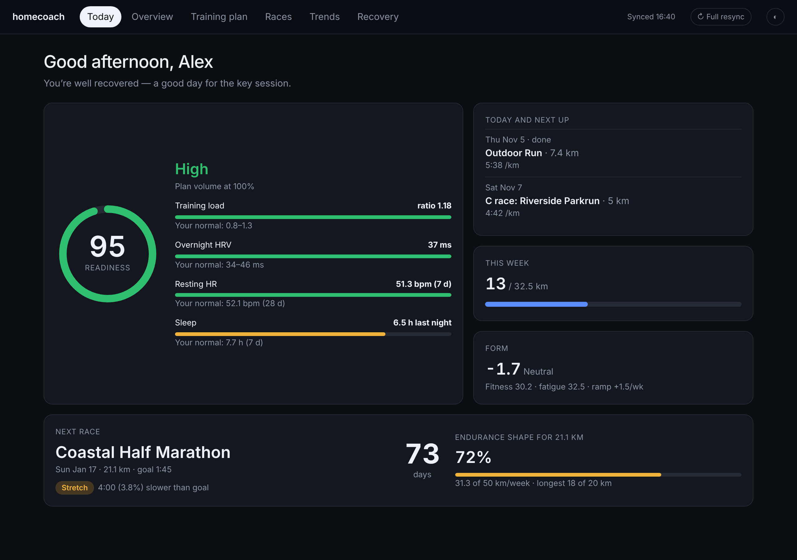
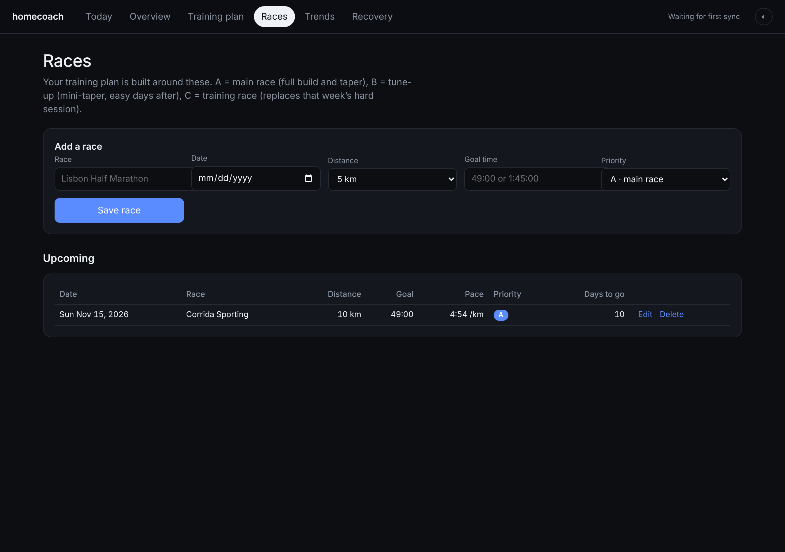
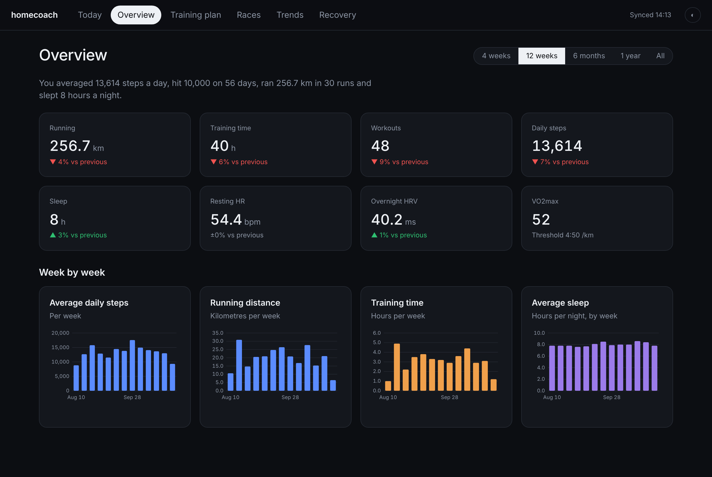
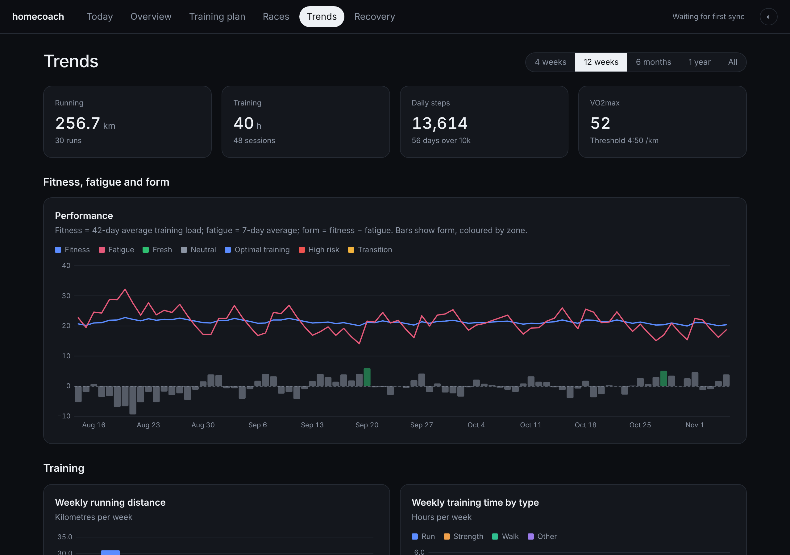
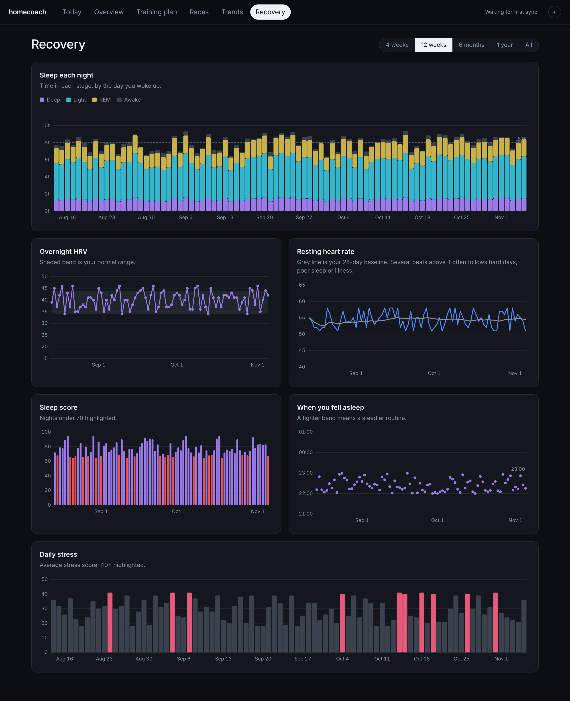
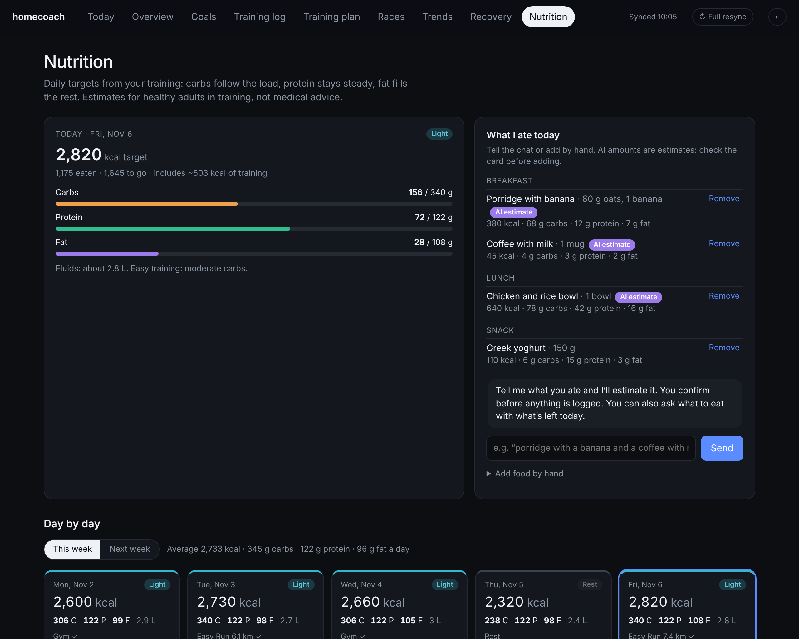
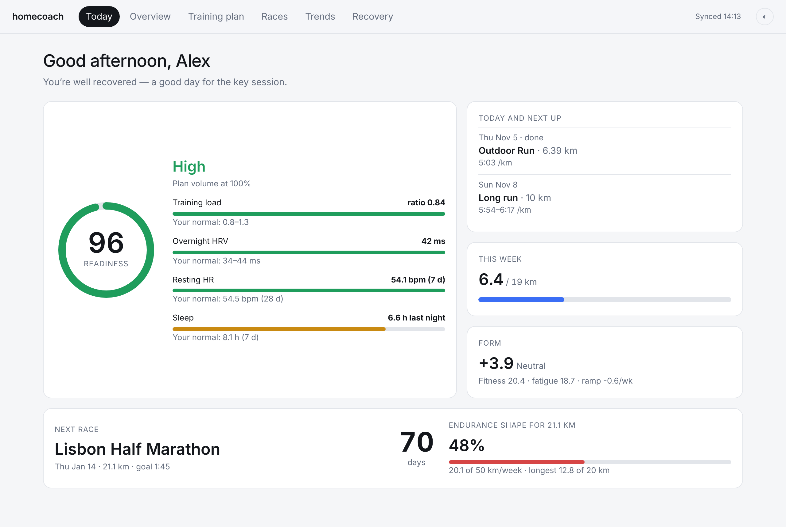
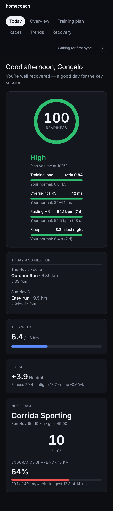

# homecoach

**Your own training coach, running on your own server.** homecoach pulls your watch data (COROS today, more to come),
keeps it in your own database, and turns your race calendar into a week-by-week plan that adapts to how you're actually
doing. It's built for TrueNAS SCALE and runs on any Docker host. Data is stored on your server, and every recommendation
comes from fixed rules; the app never calls an AI model.



## What it does

- **Today**: a 0–100 readiness score with what's driving it (training load, overnight HRV, resting HR, sleep), each
  compared with *your* normal range. Below that: the next sessions to do, how much you ran in the last 7 days, your
  form, and a countdown to your next race, with an "endurance shape" showing whether your training volume is enough for
  that distance.
- **Training plan**: a to-do list of the sessions for the next 7 days, in order but not tied to weekdays, and everything
  you did in the last 7 days. The plan is built around your race calendar: it moves through base, build, peak and taper
  phases, and A, B and C races each shape it differently. A road-to-race-day chart shows the weeks you've actually run
  followed by the planned ones.
- **Check-in**: tell the plan you feel good, tired, sore, ill or travelling. Fixed rules ease the next few days, for
  example *sore* turns hard sessions into easy runs, cuts runs by 30% and drops strength. Races are never changed.
- **Add a race with Claude**: describe the race ("Lisbon Half, goal 1:45:00"), copy the prompt the app writes into
  Claude with web search on, and paste Claude's JSON answer back. The app checks it and shows a race card. Nothing is
  saved until you click Add.
- **Am I on track?** For every race with a goal time: your goal pace against the watch's race prediction, your best
  recent run converted to the race distance, kilometres run at goal pace in the last 4 weeks and your endurance shape,
  with a verdict (*on track*, *within reach*, *stretch* or *ambitious*), a short written reading and up to three focus
  points, all from rules.
- **Nutrition**: calories, carbs, protein, fat and fluids for every day of this week and next, worked out from that day's
  training. Carbs follow the load (rest day, easy run, key session, long run, carb loading before a half or marathon, race
  day), protein stays steady and fat fills the rest. To log a meal, describe it, copy the prompt into Claude and paste
  its answer back; the app checks that the calories match the macros, and nothing is logged until you confirm. You can
  also add food by hand. Your weight, height, birthday and sex come from COROS, or you enter them once.
- **Overview, Trends and Recovery**: totals compared with the previous period, a fitness / fatigue / form chart, pace vs
  heart rate, running efficiency, activity and step calendars, sleep stages, HRV and resting HR against your baseline,
  and stress.
- **Goals**: recurring weekly, monthly or yearly targets for distance, time or sessions, by sport or across all sports.
  Edit targets and follow progress from recorded activities, including strength work. Goals do not increase the plan's
  training load automatically.
- **Training log**: search activity names, filter by sport and dates, and page through your history. Compare monthly
  distance, time and session totals with the same months last year; the current month compares elapsed days only.
- **Grafana** (optional), pointed at the same database for your own analysis.

Pages load instantly because they read from the local database. A collector keeps it up to date every 10 minutes, and
**↻ Full resync** (top right) re-reads your whole history and rebuilds the plan. Races and check-ins are kept.

See [feature choices](docs/FEATURES.md) for the comparison with other training apps, and [the audit](docs/AUDIT.md) for
fixes and verification limits.

## Screenshots

<sub>Synthetic demo data: “Alex”, building towards a half marathon, with a tune-up 10K and a parkrun on the way. Regenerate it with `backend/scripts/seed_demo.py`.</sub>

| Races | Overview |
|---|---|
|  |  |

| Trends | Recovery |
|---|---|
|  |  |

**Nutrition**



| Light theme | Mobile |
|---|---|
|  |  |

## How it works

```
 COROS (or FIT files)  ──►  collector  ──►  Postgres  ◄──  web (FastAPI + UI)  ◄── you
                         every 10 min                 ◄──  Grafana (optional)
                         + nightly full re-sync
```

| Service     | What it does                                                                                      |
|-------------|---------------------------------------------------------------------------------------------------|
| `db`        | Postgres 16. Your data lives here and in the FIT archive.                                         |
| `web`       | API and UI on port 8742. Runs database migrations on start.                                       |
| `collector` | Incremental sync every `HC_SYNC_INTERVAL_MINUTES`, full re-sync nightly, imports `/data/fit-inbox`. |
| `backup`    | Daily gzipped `pg_dump` into your backup dataset, keeping 14 days.                                |
| `grafana`   | Optional, in `docker-compose.grafana.yml`.                                                         |

### Data sources (providers)

Providers live in `backend/src/homecoach/providers/` and map vendor data into one neutral model
(`activities`, `daily_metrics`, `fitness_snapshots`). To add Garmin, Strava or anything else, implement the
`Provider` protocol in `providers/base.py` and register it in `providers/__init__.py`.

- **`coros-mcp`** (recommended): the official [COROS MCP server](https://mcp.coros.com). Click **Connect COROS** in
  the app and sign in on the COROS page; homecoach stores a token, never your password. It brings activities, daily
  steps, calories, stress, sleep stages and sleep score, bedtime, HRV, resting HR, training load, VO2max and race
  predictions. Check it with `sudo docker exec ix-homecoach-web-1 homecoach coros-check`.
  - COROS only sends a login back to an `https` address or to `localhost`. If you open homecoach over plain
    `http://<nas>:8742`, the banner walks you through one extra step: sign in in a new tab, and when that tab lands on
    an error page at `localhost/homecoach-coros-callback…` (expected), copy its address and paste it into homecoach.
    Behind an https reverse proxy, the login comes straight back instead.
- **`coros`**: the COROS Training Hub web API.
  > ⚠️ This API is **unofficial and undocumented**. It's what `training.coros.com` uses, reverse-engineered by
  > community projects, and it can change or break without notice. The client reads fields defensively and stores raw
  > payloads, so a change degrades the data instead of crashing. If it breaks, use the FIT fallback below.
- **FIT inbox** (always on): drop `.fit` files into `/data/fit-inbox` and they're imported and archived. It skips
  duplicates of activities that are already synced.

### Plan engine

`backend/src/homecoach/plan/engine.py` holds pure, tested functions with no database access.

- **Readiness** counts warning flags: load ratio over 1.3 (over 1.5 counts as two), HRV below its normal range, and a
  7-day resting HR at least 3 bpm above the 28-day average. No flags means *Ready* at 100% of planned volume, one flag
  *Hold* at 90%, and two or more *Back off* at 75%. Signals must come from today or yesterday. If none are usable, readiness is *Unknown*, with no score and no readiness-based volume adjustment. Missing signals are listed.
- **Race plan** targets your nearest A race (or your nearest race if none is marked A). It runs through base, build,
  peak and taper phases. Volume grows about 8% a week up to a peak set by distance, every fourth week is 20% easier, and
  the taper takes 1 to 3 weeks depending on distance.
  - **B races** get a mini-taper week at 80% volume: the race replaces both the key session and the long run, and the
    following week starts easy.
  - **C races** take the place of that week's hard session.
- Paces come from your goal time when one is set, otherwise from the threshold pace (taken from the provider, set with
  `HC_THRESHOLD_PACE`, or estimated from your recent runs).
- **Check-ins** change planned sessions from today until the check-in ends (default: tired 2 days, sore, ill and
  travelling 3 days, or 1 to 14 days you choose). The newest check-in replaces older ones, and *good* ends them early.

  | Feeling | Rule |
  |---|---|
  | Tired | Hard sessions become easy runs, runs 20% shorter, strength 30 min at most |
  | Sore | Hard sessions become easy runs, runs 30% shorter, no strength |
  | Ill | Rest; a race stays, with a reminder to race only after a symptom-free day |
  | Travelling | Hard sessions become easy runs, runs at most 10 km, 20 min of bodyweight strength |
- **Race outlook reading**: consistent training is taken to close about 0.5% of race time a week, at most 3% before a
  race. A bigger gap gets a suggested goal; the focus points come from endurance shape, long-run length, time at goal
  pace and whether the taper has started.

The rules are simple and transparent. This is not a coach.

## Install on TrueNAS SCALE (24.10 or newer)

The repo is cloned onto the NAS, your settings live in a `.env` file **outside** the repo, and a TrueNAS custom app
*includes* the compose file. Updating then comes down to `git pull` plus restarting the app.

1. **Datasets.** Create `p_vault/ds_apps/homecoach` (preset **Apps**) with child datasets `postgres`, `data`, `backups`
   and `grafana`. Replace `p_vault/ds_apps` with your own pool and parent dataset throughout.
2. **Files and permissions** (System → Shell):
   ```sh
   cd /mnt/p_vault/ds_apps/homecoach
   sudo git clone https://github.com/gnvalente92/homecoach src
   sudo cp src/.env.example .env && sudo chmod 600 .env && sudo nano .env
   sudo chown -R 10001:10001 data      # app user inside the container
   sudo chown -R 472:472 grafana       # grafana user
   ```
3. **App.** Go to **Apps → Discover Apps → ⋮ → Install via YAML**, name it `homecoach`, and paste:
   ```yaml
   include:
     - path:
         - /mnt/p_vault/ds_apps/homecoach/src/docker-compose.yml
         - /mnt/p_vault/ds_apps/homecoach/src/docker-compose.grafana.yml   # remove this line if you don't want Grafana
       env_file: /mnt/p_vault/ds_apps/homecoach/.env
   ```
4. Open `http://<nas>:8742`, and Grafana at `http://<nas>:3742` if you included it. Click **Connect COROS** in the banner
   and sign in with COROS. The first sync then backfills your history.

### Update to the latest version

1. In **System → Shell**, run:
   ```sh
   cd /mnt/p_vault/ds_apps/homecoach/src && sudo git pull && sudo docker pull ghcr.io/gnvalente92/homecoach:latest
   ```
2. In **Apps → homecoach**, click **Stop**, wait until it has stopped, then click **Start**. The web container applies
   any database migrations when it starts.

**Upgrading from a version with the local AI:** `docker-compose.llm.yml` and the `searxng/` folder no longer exist. Before
step 2, edit the app (**Apps → homecoach → Edit**) and remove the `docker-compose.llm.yml` line from its `include` list,
or the app won't start. The `HC_LLM_*`, `HC_OLLAMA_*`, `HC_SEARXNG_URL`, `SEARXNG_SECRET` and `HC_COACH_REVIEW_*`
lines in `.env` are ignored and can be deleted, as can the `ollama` dataset. Migration 0007 deletes the stored coach
suggestions, coach notes and AI race readings; older check-ins remain as notes.

For backup checks, restore instructions and recovery steps, see [Operations](docs/OPERATIONS.md).

On any other Docker host: `docker compose --env-file .env -f docker-compose.yml [-f docker-compose.grafana.yml] up -d`.

## Configuration

Everything is set through environment variables prefixed `HC_`. See [`.env.example`](.env.example) for the full list.
The most common ones:

| Variable | Default | Notes |
|---|---|---|
| `HC_PROVIDER` | `coros-mcp` | `coros-mcp` (official, connect in the app), `coros` (web API) or `none` (FIT inbox only) |
| `HC_COROS_EMAIL` / `HC_COROS_PASSWORD` | – | Only for `coros`. Stored only in `.env` on your server |
| `HC_COROS_REGION` | `eu` | `eu`, `en` (Americas) or `cn` |
| `HC_SYNC_INTERVAL_MINUTES` | `10` | Incremental sync frequency |
| `HC_THRESHOLD_PACE` | – | Override, e.g. `4:50` |
| `HC_ATHLETE_NAME` | `Athlete` | Used in the greeting and headlines |
| `HC_AUTH_USER` / `HC_AUTH_PASSWORD` | – | Optional basic-auth login for the web app. The app is otherwise open to your network, so set this, or put it behind a reverse proxy, if it's reachable beyond your LAN |

## Development

```sh
cd backend && python -m venv .venv && . .venv/bin/activate && pip install -c constraints.txt -e ".[dev]"
ruff check . && ruff format --check . && mypy && pytest --cov      # what CI runs (coverage floor in pyproject.toml)
HC_DATABASE_URL=sqlite:///demo.db python scripts/seed_demo.py     # synthetic data
HC_DATABASE_URL=sqlite:///demo.db HC_PROVIDER=none HC_WEB_DIR=../web/dist uvicorn homecoach.api.main:app --port 8080
```

In a second terminal, run `cd web && npm ci && npm run dev` from the repository root. Vite proxies `/api` to port 8080.
`npm run lint` checks the UI with ESLint.

CI runs all of the above on every push, plus the database migrations on SQLite and Postgres 16 (up and down) and a
gitleaks secret scan. Dependabot opens weekly update PRs for the Python, npm, GitHub Actions and Docker pins. Tests use
synthetic data only: never commit real activities, health data or FIT files (`backend/tests/fixtures/README.md`).
A new setting needs an entry in `.env.example` and in `x-env` in `docker-compose.yml`; a test checks both.
The backend requires Python 3.12 or newer; CI uses 3.12. The frontend build uses Node 24 LTS in CI and Docker.
Refresh dependency pins deliberately with
`uv pip compile backend/pyproject.toml --extra dev --universal --python-version 3.12 --no-header --no-annotate --output-file backend/constraints.txt`
from the repository root, then run the tests and production build.

API docs are served at `/docs`. Secrets are scanned on every push with gitleaks. Run `pre-commit install` to check them
locally as well.

## Privacy

Keep credentials in `.env`; activities, races, check-ins and health metrics are stored in Postgres and the FIT archive.
The collector calls the configured activity provider; nothing else leaves the server. The race and food prompts are
copied by you: whatever you paste into Claude (your race calendar, or the day's nutrition target and what you've eaten)
goes to Claude under your own account. The application does not require a Strava account.

## License

See [LICENSE](LICENSE).
