# homecoach

**Your own training coach, running on your own server.** homecoach pulls your watch data (COROS today, more to come),
keeps it in your own database, and turns your race calendar into a week-by-week plan that adapts to how you're actually
doing. It's built for TrueNAS SCALE and runs on any Docker host. Everything stays at home, including the optional AI.

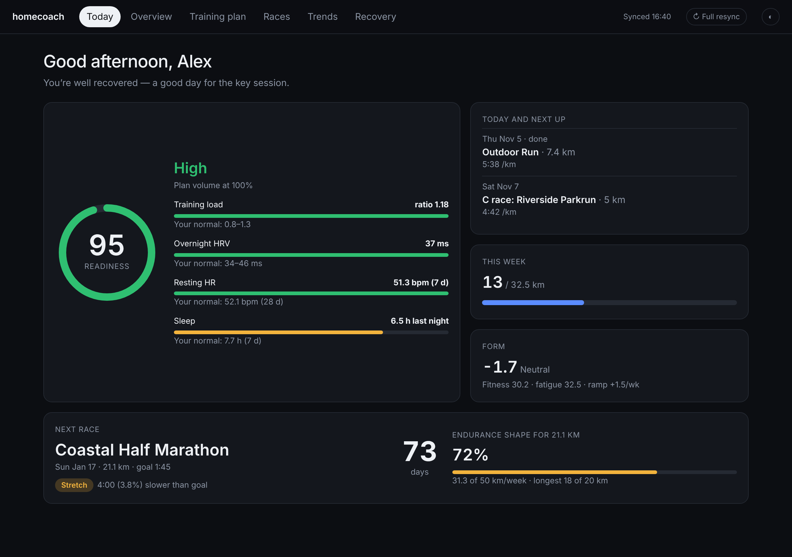

## What it does

- **Today**: a 0–100 readiness score with what's driving it (training load, overnight HRV, resting HR, sleep), each
  compared with *your* normal range. Below that: today's session and what's next, how much of the week you've done, your
  form, and a countdown to your next race, with an "endurance shape" showing whether your training volume is enough for
  that distance.
- **Training plan**: this week and next week, built around your race calendar. It moves through base, build, peak and
  taper phases, and A, B and C races each shape the plan differently. A road-to-race-day chart shows the weeks you've
  actually run followed by the planned ones.
- **Coach** (optional, local AI): tell it "calf is sore", "travelling Thu–Sat" or "tempo felt easy" and it suggests
  day-by-day changes within safe limits. You accept or dismiss each one. It also reviews your week every Sunday.
- **Race assistant** (optional, local AI): "Add Corrida do Sporting, I want 49 minutes". It searches the web, reads the
  official page and shows you a race card. Nothing is saved until you click Add.
- **Am I on track?** For every race with a goal time: your goal pace against the watch's race prediction, your best
  recent run converted to the race distance, kilometres run at goal pace in the last 4 weeks and your endurance shape,
  with a verdict (*on track*, *within reach*, *stretch* or *ambitious*). The local AI can explain it in plain words and
  suggest two or three things to focus on.
- **Overview, Trends and Recovery**: totals compared with the previous period, a fitness / fatigue / form chart, pace vs
  heart rate, running efficiency, activity and step calendars, sleep stages, HRV and resting HR against your baseline,
  and stress.
- **Grafana** (optional), pointed at the same database for your own analysis.

Pages load instantly because they read from the local database. A collector keeps it up to date every 10 minutes, and
**↻ Full resync** (top right) re-reads your whole history and refreshes the plan and race outlooks on demand.

## Screenshots

<sub>Synthetic demo data.</sub>

| Training plan and coach | Races and race assistant |
|---|---|
| 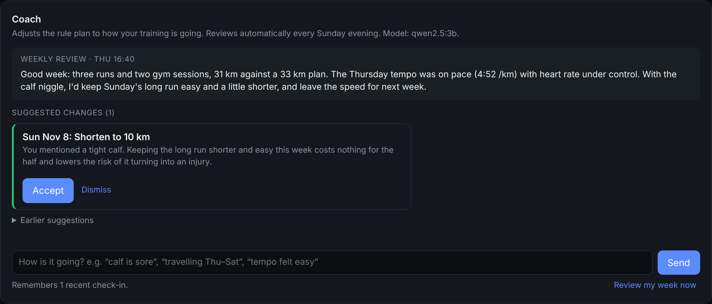 | 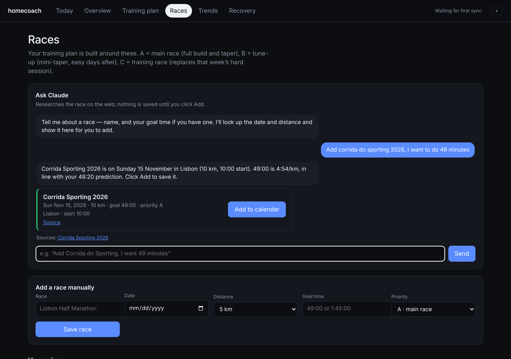 |
| 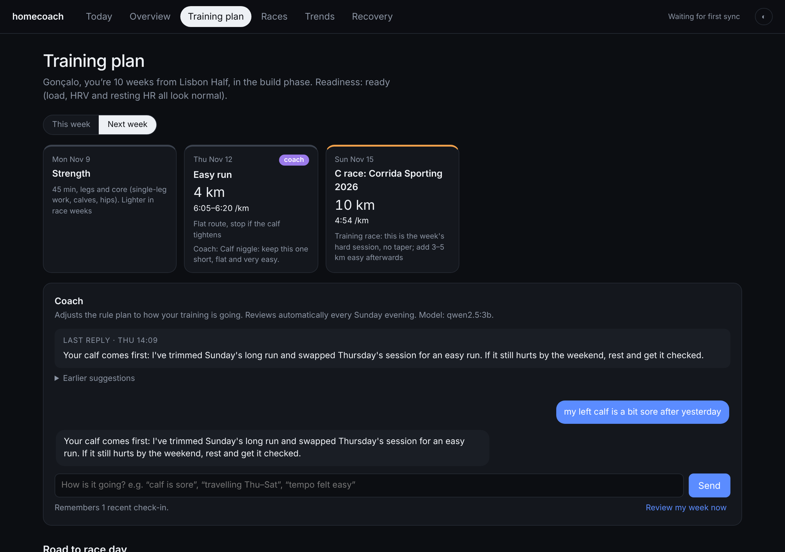 | 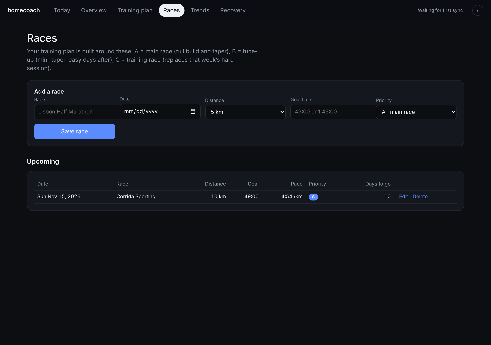 |

| Overview | Trends |
|---|---|
| 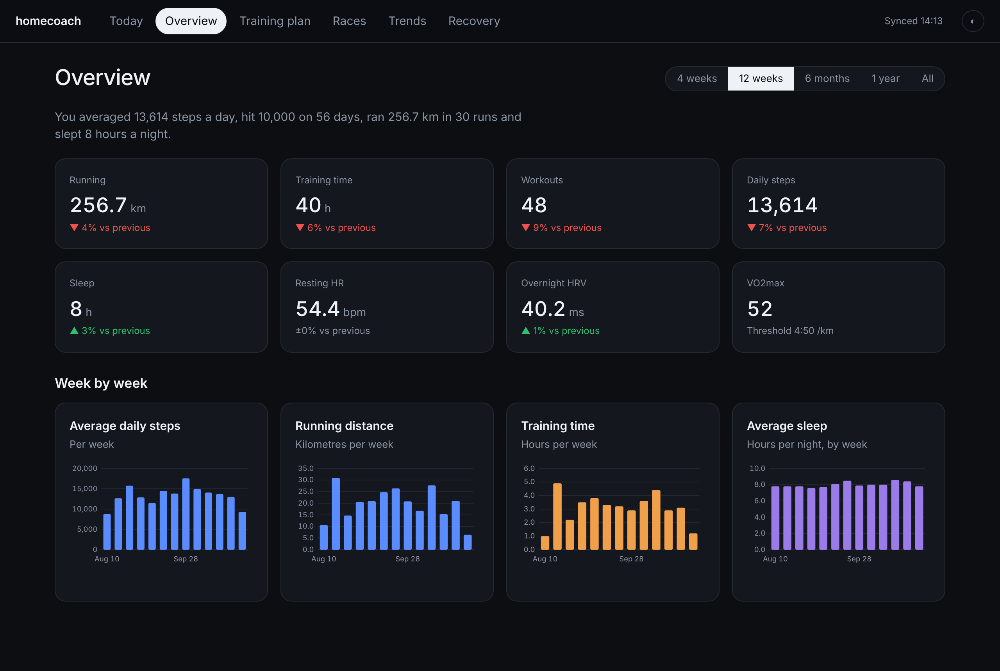 | 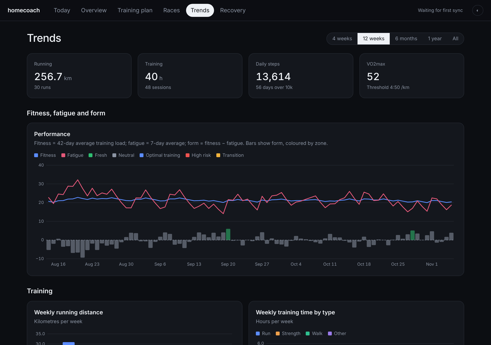 |

| Recovery | Training plan |
|---|---|
| 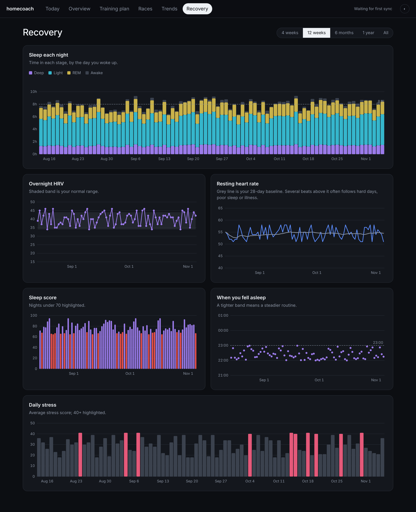 | 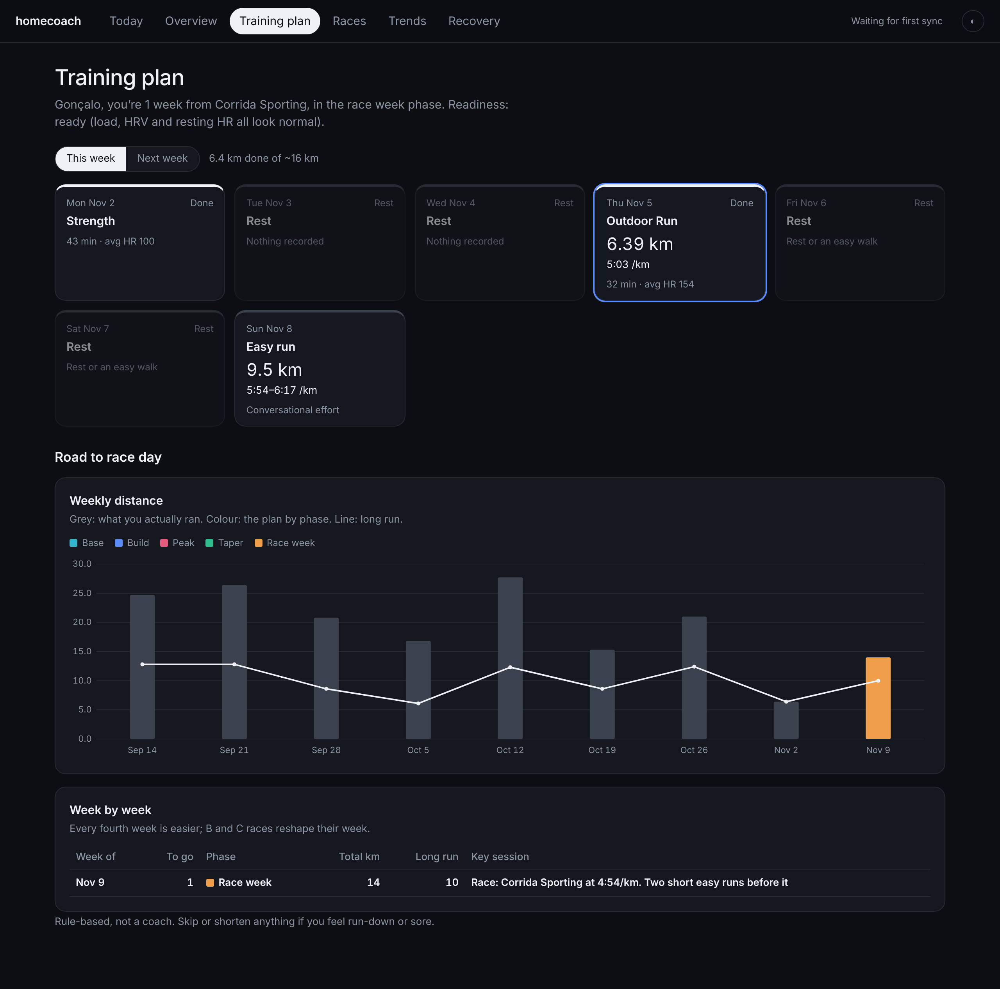 |

| Am I on track? | |
|---|---|
| 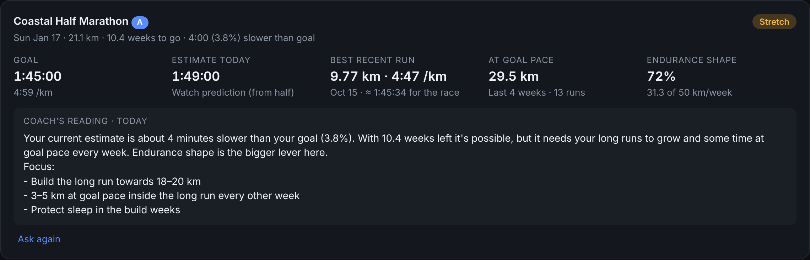 | |

| Light theme | Mobile |
|---|---|
| 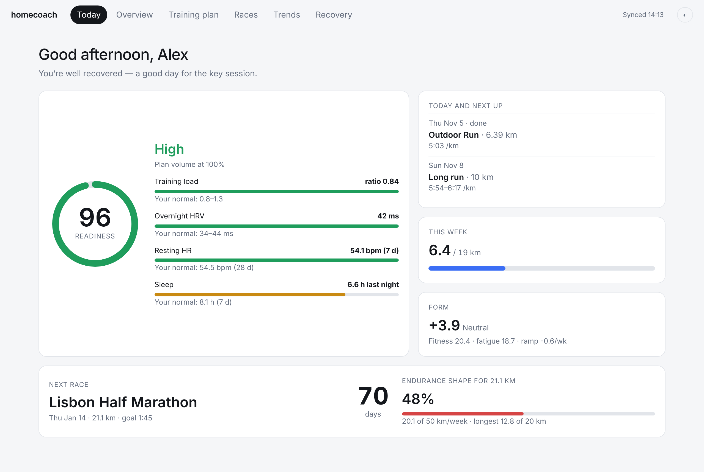 | 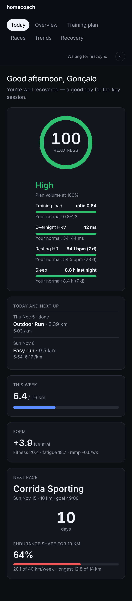 |

## How it works

```
 COROS (or FIT files)  ──►  collector  ──►  Postgres  ◄──  web (FastAPI + UI)  ◄── you
                         every 10 min                 ◄──  Grafana (optional)
                         + nightly full re-sync
```

| Service     | What it does                                                                                      |
|-------------|---------------------------------------------------------------------------------------------------|
| `db`        | Postgres 16. Your data lives here and in the FIT archive.                                         |
| `web`       | API and UI on port 8742. Runs database migrations on start.                                       |
| `collector` | Incremental sync every `HC_SYNC_INTERVAL_MINUTES`, full re-sync nightly, imports `/data/fit-inbox`. |
| `backup`    | Daily gzipped `pg_dump` into your backup dataset, keeping 14 days.                                |
| `grafana`   | Optional, in `docker-compose.grafana.yml`.                                                         |

### Data sources (providers)

Providers live in `backend/src/homecoach/providers/` and map vendor data into one neutral model
(`activities`, `daily_metrics`, `fitness_snapshots`). To add Garmin, Strava or anything else, implement the
`Provider` protocol in `providers/base.py` and register it in `providers/__init__.py`.

- **`coros-mcp`** (recommended): the official [COROS MCP server](https://mcp.coros.com). Click **Connect COROS** in
  the app and sign in on the COROS page; homecoach stores a token, never your password. It brings activities, daily
  steps, calories, stress, sleep stages and sleep score, bedtime, HRV, resting HR, training load, VO2max and race
  predictions. Check it with `sudo docker exec ix-homecoach-web-1 homecoach coros-check`.
  - COROS only sends a login back to an `https` address or to `localhost`. If you open homecoach over plain
    `http://<nas>:8742`, the banner walks you through one extra step: sign in in a new tab, and when that tab lands on
    an error page at `localhost/homecoach-coros-callback…` (expected), copy its address and paste it into homecoach.
    Behind an https reverse proxy, the login comes straight back instead.
- **`coros`**: the COROS Training Hub web API.
  > ⚠️ This API is **unofficial and undocumented**. It's what `training.coros.com` uses, reverse-engineered by
  > community projects, and it can change or break without notice. The client reads fields defensively and stores raw
  > payloads, so a change degrades the data instead of crashing. If it breaks, use the FIT fallback below.
- **FIT inbox** (always on): drop `.fit` files into `/data/fit-inbox` and they're imported and archived. It skips
  duplicates of activities that are already synced.

### Plan engine

`backend/src/homecoach/plan/engine.py` holds pure, tested functions with no database access.

- **Readiness** counts warning flags: load ratio over 1.3 (over 1.5 counts as two), HRV below its normal range, and a
  7-day resting HR at least 3 bpm above the 28-day average. No flags means *Ready* at 100% of planned volume, one flag
  *Hold* at 90%, and two or more *Back off* at 75%.
- **Race plan** targets your nearest A race (or your nearest race if none is marked A). It runs through base, build,
  peak and taper phases. Volume grows about 8% a week up to a peak set by distance, every fourth week is 20% easier, and
  the taper takes 1 to 3 weeks depending on distance.
  - **B races** get a mini-taper week at 80% volume: the race replaces both the key session and the long run, and the
    following week starts easy.
  - **C races** take the place of that week's hard session.
- Paces come from your goal time when one is set, otherwise from the threshold pace (taken from the provider, set with
  `HC_THRESHOLD_PACE`, or estimated from your recent runs).

The rules are simple and transparent. This is not a coach.

## Install on TrueNAS SCALE (24.10 or newer)

The repo is cloned onto the NAS, your settings live in a `.env` file **outside** the repo, and a TrueNAS custom app
*includes* the compose file. Updating then comes down to `git pull` plus restarting the app.

1. **Datasets.** Create `tank/apps/homecoach` (preset **Apps**) with child datasets `postgres`, `data`, `backups`
   and `grafana`. Replace `tank` with your pool name throughout.
2. **Files and permissions** (System → Shell):
   ```sh
   cd /mnt/tank/apps/homecoach
   sudo git clone https://github.com/gnvalente92/homecoach src
   sudo cp src/.env.example .env && sudo chmod 600 .env && sudo nano .env
   sudo chown -R 10001:10001 data      # app user inside the container
   sudo chown -R 472:472 grafana       # grafana user
   ```
3. **App.** Go to **Apps → Discover Apps → ⋮ → Install via YAML**, name it `homecoach`, and paste:
   ```yaml
   include:
     - path:
         - /mnt/tank/apps/homecoach/src/docker-compose.yml
         - /mnt/tank/apps/homecoach/src/docker-compose.grafana.yml   # remove this line if you don't want Grafana
       env_file: /mnt/tank/apps/homecoach/.env
   ```
4. Open `http://<nas>:8742`, and Grafana at `http://<nas>:3742` if you included it. Click **Connect COROS** in the banner
   and sign in with COROS. The first sync then backfills your history.

**Update:** run `cd /mnt/tank/apps/homecoach/src && sudo git pull && sudo docker pull ghcr.io/gnvalente92/homecoach:latest`,
then **Stop** and **Start** the app.

**Restore a backup:** run `gunzip -c backups/homecoach-YYYY-MM-DD.sql.gz | sudo docker exec -i homecoach-db-1 psql -U homecoach homecoach`.
Run `sudo docker ps` to check the container name.

On any other Docker host: `docker compose --env-file .env -f docker-compose.yml [-f docker-compose.grafana.yml] up -d`.

## Optional: local AI (race assistant and coach)

Both features run fully on your own server, with no API costs, using **Ollama** for the model and **SearXNG**
for web search. They're off until you enable them.

- **Race outlook** (Races page): "Ask the coach to explain" turns the on-track facts into a short reading and 2–3 focus
  points. It's cached for the day and refreshed for your target race with the Sunday review.

- **Race assistant** (Races page): type something like "add Corrida do Sporting, I want 49 minutes". It searches the web,
  reads the official page and shows a race card. **Nothing is saved until you click Add.**
- **Coach** (Training plan page): the rule engine still builds the plan. The coach reads how training is actually going
  (the last 8 weeks, this week so far, readiness, and your check-ins such as "calf is sore" or "travelling Thu–Sat")
  and suggests day-by-day changes: replace, shorten, skip, or move within the week. Each suggestion has a reason, and you
  **Accept** or **Dismiss** it. Guardrails reject anything that pushes a week more than 10% over the plan, or a run more
  than 15% over your longest recent run; the model is told why and asked to revise. A review runs automatically every
  Sunday at 19:00, and there's also a "Review my week now" button.

**Enable on TrueNAS**

1. Create a dataset `…/homecoach/ollama` (preset Apps) for the model files.
2. In `.env`, set:
   ```ini
   HC_LLM_PROVIDER=openai
   HC_LLM_MODEL=qwen2.5:3b
   HC_OLLAMA_PATH=/mnt/<pool>/<path>/homecoach/ollama
   SEARXNG_SECRET=<a random string>
   ```
3. Add `docker-compose.llm.yml` to the app's `include` list (see `deploy/truenas-app.yaml`), then Stop and Start the app.
   The `ollama-pull` container downloads the model (about 2 GB) once and then exits.
4. Check everything works: `sudo docker exec ix-homecoach-web-1 homecoach llm-check`

**Model choice** (CPU-only works; Ollama can't use Intel iGPUs):

| Model | RAM | Speed on a 6-core desktop CPU | Notes |
|---|---|---|---|
| `qwen2.5:3b` | ~2.5 GB | race lookup ~1–2 min | Default; reliable tool calling |
| `qwen2.5:7b` | ~5.5 GB | ~2× slower | Better judgement for the coach |

Any OpenAI-compatible server works (llama.cpp, LM Studio, vLLM, a remote box with a GPU): point `HC_LLM_BASE_URL` at it.
`HC_LLM_PROVIDER=anthropic` with `HC_LLM_API_KEY` uses the Claude API instead, which is paid.

Small local models make mistakes. That's why every race and plan change needs your confirmation, and why the rules,
not the model, set your training load.

## Configuration

Everything is set through environment variables prefixed `HC_`. See [`.env.example`](.env.example) for the full list.
The most common ones:

| Variable | Default | Notes |
|---|---|---|
| `HC_PROVIDER` | `coros-mcp` | `coros-mcp` (official, connect in the app), `coros` (web API) or `none` (FIT inbox only) |
| `HC_COROS_EMAIL` / `HC_COROS_PASSWORD` | – | Only for `coros`. Stored only in `.env` on your server |
| `HC_COROS_REGION` | `eu` | `eu`, `en` (Americas) or `cn` |
| `HC_SYNC_INTERVAL_MINUTES` | `10` | Incremental sync frequency |
| `HC_THRESHOLD_PACE` | – | Override, e.g. `4:50` |
| `HC_ATHLETE_NAME` | `Athlete` | Used in the greeting and headlines |
| `HC_LLM_PROVIDER` / `HC_LLM_MODEL` | `none` / `qwen2.5:3b` | Local AI, see above |
| `HC_AUTH_USER` / `HC_AUTH_PASSWORD` | – | Optional basic-auth login for the web app. The app is otherwise open to your network, so set this, or put it behind a reverse proxy, if it's reachable beyond your LAN |

## Development

```sh
cd backend && python -m venv .venv && . .venv/bin/activate && pip install -e ".[dev]"
pytest && ruff check .
HC_DATABASE_URL=sqlite:///demo.db python scripts/seed_demo.py     # synthetic data
HC_DATABASE_URL=sqlite:///demo.db HC_PROVIDER=none HC_WEB_DIR=../web/dist uvicorn homecoach.api.main:app --port 8080
cd ../web && npm install && npm run dev                            # UI with hot reload, proxies /api to :8080
```

API docs are served at `/docs`. Secrets are scanned on every push with gitleaks. Run `pre-commit install` to check them
locally as well.

## Privacy

The repository contains no personal data. Your credentials, races, activities and health metrics stay in `.env`, Postgres
and the FIT archive on your own server. The app makes outbound calls only to your configured provider (and, if enabled, your own SearXNG for race lookups).

## License

See [LICENSE](LICENSE).
